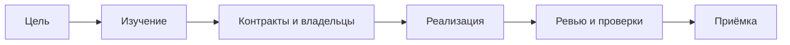

# AI Agent Playbook

**Как организовать разработку с ИИ-агентами и проверить результат.**

Практическое руководство на русском языке: от небольшой задачи одному исполнителю
до параллельной работы над независимыми модулями. Для разработчиков и тех, кто
организует разработку с помощью ИИ и хочет понимать процесс.

*Russian-language guide to coordinating AI coding agents: scoped tasks, ownership,
contracts, review, and evidence-based acceptance. Includes reusable templates.*

## Начать за пять минут

1. Опишите одно наблюдаемое изменение и критерии готовности.
2. Заполните [карточку задачи](templates/task.md): база, файлы, ограничения, проверки.
3. Начните с одного исполнителя. Делегируйте только независимую проверяемую часть.
4. Попросите [отчёт](templates/result.md) с изменениями, результатами и неизвестными.
5. Проверьте общий кандидат по [протоколу](templates/verification.md).

**[Читать полное руководство →](docs/guide.ru.md)**

## Что внутри

- 19 разделов о ролях, границах задач, контрактах и интеграции.
- 10 готовых промптов для анализа, реализации, ревью и тестирования.
- Сквозной учебный пример: импорт JSON в локальный список задач.
- Четыре отдельных шаблона для повседневной работы.
- Честное разделение «предложено», «реализовано», «проверено» и «принято».



## Навигация

| Материал | Назначение |
|---|---|
| [Руководство](docs/guide.ru.md) | Полный процесс и промпты |
| [Карточка задачи](templates/task.md) | Ограничить работу исполнителя |
| [Отчёт исполнителя](templates/result.md) | Передать результат с доказательствами |
| [Протокол проверки](templates/verification.md) | Записать ожидание и наблюдаемый результат |
| [Архитектурное решение](templates/decision.md) | Объяснить существенный выбор |
| [Участие](CONTRIBUTING.md) | Предложить исправление |
| [Проверка выпуска](docs/RELEASE_CHECK.md) | Область и ограничения проверки |

## Как использовать

Читайте Markdown в GitHub или любом локальном редакторе. Установка, аккаунты,
API-ключи и платные сервисы для чтения не нужны. Копируйте подходящий шаблон
в свой проект и заполняйте поля перед выдачей задачи.

Это документация, а не система запуска агентов. Возможности делегирования,
изолированных рабочих копий и доступа к инструментам зависят от вашей среды.
Если субагентов нет, роли можно выполнять последовательно; самопроверка при этом
не становится независимым ревью.

Для проверки структуры материалов требуется Python 3.10+ без сторонних пакетов:

```sh
python scripts/check_docs.py
```

Скрипт проверяет локальные ссылки, явные якоря, блоки кода и комплектность.
Он не является полноценным сканером секретов и не проверяет внешние сайты.

## Авторство и ограничения

Материалы подготовлены с помощью ИИ под руководством владельца проекта.
ИИ помогал формулировать и редактировать текст; ответственность за требования,
выбор материалов и выпуск остаётся у человека. Методика — практические рекомендации,
а не научно доказанный оптимум и не официальный стандарт поставщика ИИ.
Пример приложения учебный: исходники приложения и результаты его тестов не поставляются.

## Лицензия

[MIT](LICENSE) распространяется на оригинальный текст, шаблоны и скрипт этого
репозитория. Источники по внешним ссылкам сохраняют собственные условия.
Подробнее: [THIRD_PARTY_NOTICES.md](THIRD_PARTY_NOTICES.md).
