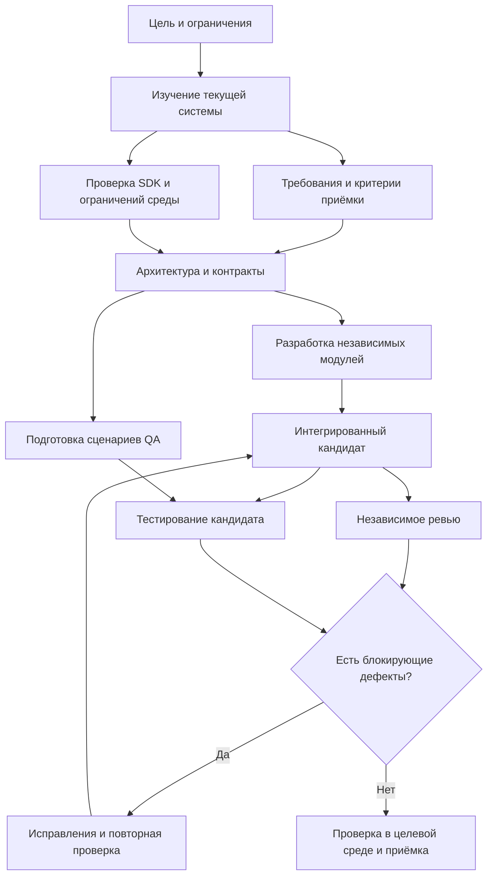

# Работа с агентами

Практическое руководство по организации разработки ПО с главным агентом и субагентами. Подходит для локальных утилит, веб-приложений, интеграций и других проектов, где нужны исследование, реализация и независимая проверка.

> [!TIP] С чего начать
> Для сложной функции разумная стартовая схема — **оркестратор, разработчик, независимый ревьюер и QA**. Аналитика, архитектора и исследователя SDK/API подключать по необходимости. Роли можно выполнять последовательно: восемь обязанностей не означают восемь постоянно работающих агентов.
>
> Базовый порядок: **изучение → диагностика → минимальное изменение → проверка → приёмка**. Параллелизм полезен там, где задачи независимы и результат каждой можно проверить отдельно.

## Содержание

- [1. Что считать агентом, ролью и командой](#section-1)
- [2. Рекомендуемые роли и ответственность](#section-2)
- [3. Сколько агентов нужно](#section-3)
- [4. Последовательность работы и параллельные этапы](#section-4)
- [5. Файлы, ветки и интеграция](#section-5)
- [6. Контракт передачи задачи](#section-6)
- [7. Формат результата субагента](#section-7)
- [8. Независимое ревью и цикл исправлений](#section-8)
- [9. QA и стратегия тестирования](#section-9)
- [10. Проверка API без выдуманных возможностей](#section-10)
- [11. Критерии готовности](#section-11)
- [12. Журнал решений и состояние проекта](#section-12)
- [13. Контекст, доступы и недоверенные данные](#section-13)
- [14. Время, стоимость и пределы параллелизма](#section-14)
- [15. Сквозной пример: локальный список задач](#section-15)
- [16. Готовые промпты](#section-16)
- [17. Типичные ошибки](#section-17)
- [18. Ежедневный рабочий порядок](#section-18)
- [19. Источники и границы рекомендаций](#section-19)

<a id="section-1"></a>

## 1. Что считать агентом, ролью и командой

**Агент** — отдельный исполнитель со своим контекстом, инструментами и задачей. **Субагент** — исполнитель, которому главный агент делегировал ограниченную часть работы. **Роль** — набор обязанностей; один агент может выполнять несколько ролей в разное время.

**Оркестратор** сохраняет общую цель, распределяет работу, принимает результаты и отвечает за интеграцию. Пользователь определяет полезный результат, ограничения и приёмку. Ответственность за проект нельзя распределить так, чтобы никто не отвечал за итог.

Название роли само по себе ничего не гарантирует. «Архитектор» без доступа к реальному коду может предложить несовместимое решение; «критик» без требований и diff не сможет провести содержательное ревью.

Несколько агентов способны повторить одну ошибку, особенно если получили одно неверное предположение. Согласие команды не заменяет документацию, исполняемую проверку и наблюдение в целевой среде.

<a id="section-2"></a>

## 2. Рекомендуемые роли и ответственность

| Роль | Основная задача | Проверяемый результат | Когда выделять отдельно |
|---|---|---|---|
| Оркестратор / технический руководитель | Декомпозиция, зависимости, границы, интеграция, итоговый отчёт | План, задачи, состояние проверок, единый кандидат | При любой работе с субагентами |
| Аналитик | Уточнить проблему, сценарии и ожидаемое поведение | Требования, примеры входов/выходов, критерии приёмки | Неясные требования, сложная предметная область |
| Архитектор | Выбрать границы модулей, контракты, модель данных и способ интеграции | Краткое решение, альтернативы, интерфейсы, риски | Изменения нескольких подсистем или общих контрактов |
| Исследователь SDK/API | Проверить возможности конкретной версии и ограничения среды | Реестр API с источниками, версиями и неизвестными | внешняя система, закрытый SDK, новая библиотека или интеграция |
| Разработчик A/B/... | Реализовать ограниченный модуль | Небольшой diff, локальные проверки, отчёт | По одному на независимую область изменений |
| Независимый ревьюер | Найти ошибки в поведении, данных, правах и совместимости | Замечания с доказательствами и приоритетом | Сложные изменения, интеграции, работа с данными |
| QA / тестировщик | Проверить результат по требованиям, включая негативные случаи | Матрица сценариев, результаты запусков, дефекты | Пользовательские сценарии, регрессии, целевая среда |

Дополнительно можно временно подключать специалиста по безопасности, производительности или UX. Делать это стоит под конкретный риск: например, независимую проверку разграничения доступа или профилирование медленного сценария.

### Какие роли можно совмещать

- Оркестратор может выполнять первичную аналитику и принимать простые архитектурные решения.
- Аналитик и архитектор могут быть одним агентом в небольшом проекте.
- Разработчик обязан проводить самопроверку и писать нужные тесты.
- Ревьюер может помогать составлять тестовые сценарии, но для рискованной функции полезно отдельное QA.

**Самопроверку автора нельзя выдавать за независимое ревью.** Для независимого ревью нужен другой агент или человек, который самостоятельно читает требования и код. Ему можно передать объяснение автора, но вывод он строит по проверяемым материалам.

<a id="section-3"></a>

## 3. Сколько агентов нужно

Ниже — рабочие ориентиры, а не экспериментально доказанный оптимум и не ограничения конкретного продукта. Количество включает оркестратора. Число разных исполнителей за весь проект может быть больше одновременной активности.

| Задача | Разных агентов за цикл | Обычно одновременно | Состав |
|---|---:|---:|---|
| Маленькое исправление в известном коде | 1–2 | 1–2 | Исполнитель; при существенном риске отдельный ревьюер |
| Локальная функция с понятным контрактом | 2–3 | 2–3 | Оркестратор/аналитик, разработчик, ревьюер/QA |
| Сложная функция в одной подсистеме | 4–5 | 2–4 | Оркестратор, разработчик, ревьюер, QA; исследователь при неизвестном API |
| Плагин с незнакомым SDK | 5–6 | 2–4 | Оркестратор/аналитик, архитектор, исследователь SDK, разработчик, ревьюер, QA |
| Изменение нескольких независимых модулей | 6–8 | 3–5 | Основные роли и 2–3 разработчика по отдельным областям |
| Большой продукт | По отдельным направлениям | Ограничивать на каждом направлении | Несколько небольших команд с владельцами контрактов и общей интеграцией |

**Для сложного кода начать с четырёх ролей, а не с максимального числа агентов.** Если главный риск — неизвестный SDK, первым дополнительным исполнителем будет исследователь. Если контракты уже ясны, а независимых модулей два, полезнее второй разработчик.

Добавлять агента стоит, когда одновременно выполнены условия:

1. Есть отдельный проверяемый результат.
2. Задача не ожидает ещё не принятого решения другой задачи.
3. Есть собственная область файлов либо работа только на чтение.
4. Оркестратор сможет принять и интегрировать результат.
5. Ожидаемый выигрыш превышает затраты на передачу контекста и проверку.

Если исполнитель постоянно ждёт уточнений или все меняют один класс, увеличение команды обычно не помогает.

### Если доступно только четыре одновременных места

Это пример планирования, а не универсальный лимит инструмента. Сначала выяснить доступные возможности текущего клиента и сессии, а также учитывается ли главный агент в лимите.

- Исследование: оркестратор + аналитик + исследователь SDK + архитектор.
- Реализация: оркестратор + разработчик A + разработчик B + QA, готовящий сценарии.
- Приёмка кандидата: оркестратор + ревьюер + QA; разработчик подключается для исправлений.

Завершённые роли освобождают место. Не нужно держать всех исполнителей активными на протяжении проекта.

<a id="section-4"></a>

## 4. Последовательность работы и параллельные этапы



### Этап 0. Зафиксировать границы

Определить, что разрешено: только изучение, локальная реализация, тестовый запуск или также развёртывание. Найти активный исходный проект, локальные инструкции, версии зависимостей и незакоммиченные изменения. Зафиксировать базовый commit или иной воспроизводимый снимок.

Для пользовательских рабочих систем сначала изучать состояние. Сборка плагина, изменение конфигурации, замена установленной DLL и запись данных — разные действия; разрешение на одно не означает автоматически разрешения на остальные.

### Этап 1. Параллельное изучение

Аналитик описывает текущий и ожидаемый сценарий. Исследователь проверяет SDK и версии. QA изучает существующие тесты и способ воспроизведения. Архитектор исследует точки расширения, но окончательное решение принимает после проверки критичных ограничений.

На выходе: подтверждённые факты, неизвестные, риски и критерии приёмки. Если ключевой API не найден, это ограничение плана, а не повод написать похожий по названию вызов.

### Этап 2. Согласовать контракты

Оркестратор и архитектор фиксируют границы модулей, входы/выходы, ошибки, правила данных, права и владельцев общих файлов. Подготовить минимальный сквозной сценарий: он должен доказать, что выбранный путь вообще работает.

До этого этапа можно вести независимое исследование и прототипы. Массовую реализацию зависимых компонентов запускать после стабилизации нужных им контрактов.

### Этап 3. Параллельная реализация

Разработчики работают над отдельными модулями по одной версии контракта. QA параллельно готовит сценарии и тестовые данные. Ревьюер может заранее проверить архитектурный риск, а затем проверяет фактический код.

Разработчик не меняет общий интерфейс молча. Он сообщает причину и последствия; оркестратор обновляет решение и уведомляет зависимых исполнителей.

### Этап 4. Интеграция и проверка

Оркестратор собирает изменения в одного кандидата. QA и ревьюер могут работать параллельно, если проверяют один зафиксированный снимок. Если код изменился во время проверки, в отчёте должны быть разные версии; такой набор отчётов ещё не подтверждает итоговый кандидат.

### Этап 5. Целевая среда и приёмка

Выполнить предусмотренные проверки в целевой среде. Зафиксировать версии, права пользователя, сценарий и артефакт. Для интерфейса получить пользовательскую оценку удобства и внешнего вида. Развёртывать в рабочую среду только в пределах предоставленного разрешения.

**Можно распараллеливать:** чтение разных подсистем, проверку источников, независимые модули, подготовку тестов, ревью и тестирование неизменяемого кандидата.

**Нужно упорядочивать:** изменение общего контракта и его потребителей, интеграцию, миграции общей БД, замену одного установленного плагина, работу с одним изменяемым тестовым стендом.

<a id="section-5"></a>

## 5. Файлы, ветки и интеграция

### Один владелец записи на область

Каждой изменяемой области назначить владельца. Читать код могут все; одновременно менять один файл нескольким агентам в общей рабочей папке не следует.

Пример условного проекта; эти пути не описывают существующий репозиторий пользователя:

| Область | Владелец | Ограничение |
|---|---|---|
| `src/Domain/` | Разработчик A | Без зависимостей от UI и SDK |
| `src/ImportAdapter/` | Разработчик B | Только подтверждённые возможности SDK |
| `src/UI/` | Разработчик C, если нужен | Работает по контракту представления |
| `tests/Acceptance/` | QA | Проверяет требования и наблюдаемый результат |
| Общие контракты, зависимости, lock-файлы, конфигурация сборки | Назначенный интегратор | Менять последовательно, уведомляя потребителей |

Разработчики могут добавлять модульные тесты в своей области. Если тестовый файл общий, его владелец также должен быть определён.

### Git worktree и отдельные ветки

Для параллельной записи можно использовать отдельные рабочие деревья Git и ветки от согласованной базы. Worktree даёт отдельные файлы на диске; ветка в общей папке сама по себе этого не даёт. [Документация Git](https://git-scm.com/docs/git-worktree).

Пример схемы веток:

```text
База: <проверенный commit>
feature/report-domain       — доменная логика
feature/report-adapter      — адаптер импорта
feature/report-ui           — интерфейс, если нужен
integration/report          — объединённый кандидат
```

Имена условные. Не считать, что новая рабочая копия автоматически содержит локальные изменения, секреты или все настройки исходной папки: проверить реальное поведение инструмента создания.

Worktree не изолирует внешний сервер, общую БД, папку установленных DLL, порты, кэш и учётную запись. Двум агентам нужны отдельные данные/ресурсы либо очередь доступа к общему стенду.

### Порядок интеграции

1. Проверить базу, diff и локальные проверки каждого изменения.
2. Включать небольшие законченные изменения в порядке зависимостей.
3. Разрешать конфликт по смыслу требований, сохраняя нужное поведение обеих сторон.
4. После объединения выполнить интеграционные проверки.
5. Зафиксировать commit кандидата и хэш поставляемого файла.

Локальные проверки двух веток не доказывают корректность их объединения. После разрешения конфликта старое ревью конфликтного участка требует пересмотра.

Если Git нет: использовать отдельные копии и явный список файлов для переноса либо оставить одного пишущего исполнителя. Не называть копию изолированной, если она продолжает записывать в общие внешние ресурсы.

<a id="section-6"></a>

## 6. Контракт передачи задачи

Субагенту нужна ограниченная задача с понятным результатом. Формулировка «сделай качественно» не определяет ни границы, ни способ приёмки.

Шаблон карточки; угловые скобки нужно заполнить до выдачи:

```text
ID: <TASK-ID>
Роль и владелец: <кто отвечает>
Цель: <одно наблюдаемое изменение>
Режим: <только чтение / локальная реализация / иной разрешённый режим>
База: <репозиторий, абсолютный путь, ветка, commit>
Входы: <требования, файлы, версии, ссылки на доказательства>
Зависимости: <какие результаты должны быть приняты раньше>
Контракт: <версия, входы/выходы, ошибки, null, единицы, права>
Разрешено менять: <точные каталоги или файлы>
Не входит в задачу: <соседние подсистемы и отдельные операции>
Общие файлы: <владелец и порядок запроса изменения>
Ожидаемый результат: <diff / исследовательский отчёт / тестовый протокол>
Проверка: <сценарии и способ воспроизведения>
Готово, когда: <конкретные критерии>
Лимит: <объём, время или бюджет, если задан>
При блокере: <сообщить факт, источник, влияние и следующий шаг>
Формат ответа: <шаблон из раздела 7>
```

Передавать только релевантный контекст, но не убирать критичные ограничения. В задаче на адаптер должны быть версии SDK и запрет записи в рабочую систему; в задаче на UI — точная семантика состояний данных.

Для контракта данных явно определять:

- Обязательные поля, типы, идентификаторы и владельца схемы.
- Разницу между `null`, отсутствием поля, нулём, пустым списком и ошибкой.
- Единицы измерения, часовой пояс, точность и округление.
- Источник каждого значения и допустимую давность данных.
- Ошибки, отмену, тайм-ауты, повторы и идемпотентность, если они нужны.
- Права доступа и запрещённые побочные эффекты.

**Пример правила:** достоверный `0%` отображается как `0%`; неизвестный прогресс остаётся неизвестным. Значения из файла импорта, локального хранилища и демонстрационного набора не подменяют друг друга без явно согласованного правила.

При изменении контракта указывать новую версию, причину, затронутые задачи и способ обновления потребителей. Подтверждение понимания нужно только там, где изменение влияет на продолжающуюся работу.

<a id="section-7"></a>

## 7. Формат результата субагента

```text
Задача: <ID>
Статус: <выполнено / частично / заблокировано>
Проверенный снимок: <путь, ветка, commit; либо описание незакоммиченного diff>

Результат:
- <что выяснено или изменено>

Изменённые файлы:
- <путь и назначение изменения>

Доказательства:
- <источник, версия, строка/символ, сценарий или путь к протоколу>

Проверки:
- <команда или действие; фактический результат; среда>
- <что не запускалось и почему>

Неизвестные и риски:
- <что ещё не подтверждено>

Отклонения от задачи:
- <если были; иначе явно нет>

Следующий шаг:
- <одно действие, необходимое для принятия результата>
```

Разделять факт, гипотезу и предложение. «Метод найден в сборке» — факт о наличии символа; «должен работать у обычного пользователя» — гипотеза до проверки прав и runtime.

Не писать «тесты пройдены», если тесты только предложены, не запускались или завершились ошибкой настройки. Указывать отдельно: `PASS`, `FAIL`, `NOT RUN`, `BLOCKED` и фактическую причину.

Оркестратор принимает результат после сверки с карточкой задачи. Само сообщение «готово» не переводит изменение в принятые.

<a id="section-8"></a>

## 8. Независимое ревью и цикл исправлений

Ревьюер получает требования, базу сравнения, кандидат, контракты и известные ограничения. Сначала он самостоятельно изучает код и сценарии, затем сопоставляет выводы с отчётом автора.

### Что проверять

- Соответствие задаче и отсутствие лишних изменений.
- Ошибки обработки данных, граничные случаи и потерю происхождения значений.
- Права доступа, утечки, побочные эффекты и неверный контекст пользователя.
- Совместимость с подтверждённой версией SDK.
- Гонки, отмену, жизненный цикл, ресурсы и UI-поток, если применимо.
- Реальность проверок и пробелы между тестами и пользовательским сценарием.

Замечание должно содержать **условие → участок кода → неправильное поведение → последствия → способ проверки**. Если воспроизведения нет, честно обозначить, на каком анализе основан вывод.

Рабочие приоритеты:

- `P0` — критичная потеря данных, серьёзное нарушение безопасности или отказ основной системы; работу над выпуском остановить до решения.
- `P1` — основной сценарий сломан либо есть высокий риск значимой регрессии; блокирует приёмку кандидата.
- `P2` — воспроизводимая ошибка ограниченного сценария; решение принимается по критериям выпуска, с владельцем и сроком.
- `P3` — улучшение читаемости или удобства без существенного нарушения требований.

Команда заранее согласует, какие уровни блокируют конкретный выпуск. У обязательного критерия приёмки не должно быть обхода за счёт понижения приоритета.

### Цикл проверки

1. Разработчик выполняет самопроверку и передаёт кандидат.
2. Ревьюер и QA формируют проверяемые замечания.
3. Оркестратор объединяет дубликаты и назначает владельцев.
4. Разработчик делает минимальные исправления.
5. QA повторяет проваленный сценарий и нужную регрессию.
6. Ревьюер проверяет исправление и его влияние на соседний код.
7. Итоговые отчёты привязываются к актуальному кандидату.

Если обсуждение ходит по кругу, запросить минимальное воспроизведение или решение владельца требования. Например, после двух непродуктивных итераций можно пересмотреть постановку; это ориентир управления временем, а не разрешение оставить обязательный дефект.

<a id="section-9"></a>

## 9. QA и стратегия тестирования

QA строит проверки из требований и пользовательских действий. Тест, который просто повторяет алгоритм реализации, способен подтвердить ту же ошибку.

| Уровень | Что подтверждает | Чего сам по себе не подтверждает |
|---|---|---|
| Статический анализ и сборка | Корректность в пределах настроенных инструментов и ссылок | Поведение пользователя и загрузку плагина в клиенте |
| Модульные тесты | Логику изолированного компонента | Реальные права, транспорт, SDK и среду |
| Контрактные тесты | Согласованную структуру данных и взаимодействие сторон | Полный пользовательский сценарий |
| Интеграционные тесты | Совместную работу компонентов в указанной среде | Рабочее окружение иной версии или конфигурации |
| Сквозной тест | Конкретный сценарий от действия до результата | Все возможные сценарии и качество UX |
| Ручная приёмка | Ожидаемое поведение и удобство для пользователя | Отсутствие всех скрытых дефектов |

Выбирать проверки по риску. Для небольшой правки текста достаточно просмотра результата; для расчёта прогресса нужны независимые ожидаемые значения; для SDK-интеграции — проверка в подходящем хосте.

### Минимальная матрица сценариев

- Основной сценарий с известным правильным результатом.
- Пустые данные, один элемент, большой набор.
- Валидный ноль, неизвестное значение, отсутствие подходящих единиц расчёта.
- Нет доступа, частичный доступ, пользователь без административных прав.
- Ошибка внешней системы, недоступность сети и отмена, если применимо.
- Повторное действие: отсутствие дублирования и непредусмотренных записей.
- Сохранение существующего поведения в затронутой области.

Ожидаемые значения получать из спецификации, ручного расчёта или независимого эталона. Демонстрационные данные маркировать как синтетические. Проверять, что тест не обращается к рабочей системе случайно.

Шаблон протокола:

```text
Сценарий: <ID и требование>
Кандидат: <commit, хэш артефакта>
Среда: <ОС, приложение, SDK, конфигурация, тип пользователя>
Данные: <обезличенный набор и его происхождение>
Предусловия: <состояние перед проверкой>
Действия: <воспроизводимые шаги>
Ожидается: <конкретный результат>
Получено: <наблюдаемый результат>
Итог: <PASS / FAIL / NOT RUN / BLOCKED>
Свидетельство: <лог, снимок, отчёт; без секретов>
```

Падение из-за отсутствующего стенда — `BLOCKED`, а не успешная проверка. Нестабильный тест исследовать; не перезапускать до случайного зелёного результата без объяснения.

После объединения веток проверять общий кандидат. Повторять полную матрицу только при изменениях или рисках, которые этого требуют; не расходовать время на одинаковые проверки неизменившегося результата.

<a id="section-10"></a>

## 10. Проверка API без выдуманных возможностей

Название метода в ответе агента не доказывает, что такой метод существует. Проверять нужно документацию и публичные интерфейсы именно той версии, которую использует проект.

1. Найти зависимости проекта и зафиксированные версии.
2. Найти официальную документацию и примеры для этих версий.
3. Сверить точные имена, параметры, возвращаемые значения и ограничения.
4. Подготовить минимальный пример и проверить его в разрешённой среде.
5. Отдельно записать поведение при ошибках, отмене и недостаточных правах.

Различать уровни доказательств:

| Наблюдение | Что подтверждено |
|---|---|
| Метод описан в документации | Возможность описана для указанной версии |
| Метод найден в публичных интерфейсах пакета | Символ существует в проверенном пакете |
| Пример компилируется | Компилятор принимает вызов с этими зависимостями |
| Тест проходит с заглушкой | Локальная логика работает с тестовой заменой |
| Сценарий выполнен в приложении | Наблюдалось поведение в конкретной среде |

Ни один из этих результатов автоматически не доказывает остальные.

Если возможность не найдена, писать: `API NOT FOUND — проверены <источники и версии>`.
Это граница поиска, а не утверждение об отсутствии метода во всех версиях.
Для непроверенного поведения: `ТРЕБУЕТ ПРОВЕРКИ — <сценарий и среда>`.

```text
Возможность: <нужное действие>
Зависимость и версия: <пакет>
Символ: <точная сигнатура, если найдена>
Источник: <официальная страница или файл>
Проверено: <документация / компиляция / тест / запуск>
Ограничения: <ошибки, права, жизненный цикл>
Неизвестно: <что ещё проверить>
```

Не обновлять зависимости только ради успешной сборки без проверки совместимости.
Установленный пакет и локально собранный кандидат могут различаться: фиксировать версии.
Неизвестное значение не превращать в ноль; тестовые данные не выдавать за реальные.

<a id="section-11"></a>

## 11. Критерии готовности

### Готовность задачи к передаче разработчику

- [ ] Описан наблюдаемый результат и границы работы.
- [ ] Найдена правильная исходная база и учтены изменения пользователя.
- [ ] Известны критичные версии и ограничения среды.
- [ ] Контракты доступны, зависимости отмечены.
- [ ] Есть владелец файлов и способ проверки.
- [ ] Критичные неизвестные исследованы либо явно ограничивают прототип.

### Готовность локальной реализации

- [ ] Изменение соответствует требованиям и не содержит лишней переработки.
- [ ] Существенные вызовы SDK/API подтверждены источниками.
- [ ] Выполнены необходимые локальные проверки; пропуски обозначены.
- [ ] Не потеряны данные, их происхождение и значимые состояния.
- [ ] Независимое ревью завершено для актуального кандидата.
- [ ] Блокирующие замечания устранены и перепроверены.
- [ ] Есть точный кандидат, отчёт и известные ограничения.

### Готовность к рабочему использованию

- [ ] Выполнены необходимые проверки в целевой среде.
- [ ] Подтверждены нужные права пользователей.
- [ ] Проверены установка, конфигурация и зависимости в разрешённом объёме.
- [ ] Для изменений данных предусмотрены восстановление и проверка результата.
- [ ] Пользователь принял поведение; для UI также внешний вид и удобство.
- [ ] Получено необходимое разрешение на развёртывание, если оно ещё не входило в задачу.

Полезно различать статусы: **исследовано → реализовано локально → проверено в тестовой среде → принято пользователем → развёрнуто**. Статус выбирается по доказательствам; нельзя автоматически проходить все ступени после успешной сборки.

Если runtime недоступен, корректный итог: «локальная реализация завершена; проверка в приложении не выполнена; указаны блокер и следующий шаг». Не называть такую интеграцию полностью готовой к эксплуатации.

<a id="section-12"></a>

## 12. Журнал решений и состояние проекта

Долгая история чата неудобна как единственный источник состояния. Хранить краткие актуальные документы рядом с кодом. Ниже — предлагаемая структура, а не файлы, создаваемые этой заметкой:

```text
AGENTS.md                    — устойчивые правила проекта
docs/agents/plan.md           — цель, этапы, зависимости
docs/agents/tasks.md          — владельцы, статусы, блокеры
docs/agents/contracts.md      — версии контрактов
docs/agents/api-evidence.md   — источники и проверки SDK/API
docs/agents/verification.md   — матрица и протоколы проверок
docs/decisions/ADR-001.md      — существенное решение
```

В `AGENTS.md` помещать короткие применимые правила: устройство проекта, реальные команды проверки, границы, требования к API и готовности. Подробные исследования хранить отдельно и ссылаться на них. Поддержку файла инструкций нужно проверить в используемом инструменте.

Назначить владельца общего журнала; исполнители передают изменения ему или пишут отдельные отчёты. Не создавать новый конфликт записи в файле состояния.

### Шаблон решения ADR

```text
ID и дата: <ADR-ID, дата>
Статус: <предложено / принято / заменено>
Контекст: <проблема и подтверждённые ограничения>
Рассмотренные варианты: <кратко>
Решение: <выбранный вариант>
Причина: <почему подходит условиям>
Доказательства: <ссылки, версии, результаты>
Последствия: <компромиссы и затронутые модули>
Неизвестные: <что ещё не подтверждено>
Владелец: <кто отвечает>
Пересмотреть, если: <изменение условий>
Заменяет / заменено: <ID, если применимо>
```

Пример условного решения: «Доменный расчёт не зависит от SDK; адаптер передаёт данные вместе с источником и статусом доступности». Причина: можно независимо проверять расчёт и отдельно исследовать интеграцию. Это проектное предложение, а не свойство выбранной библиотеки.

### Краткий снимок состояния перед передачей работы

```text
Цель и текущий этап:
База и кандидат:
Принятые решения:
Активные задачи, владельцы и области записи:
Что подтверждено:
Что не проверено:
Блокеры и их влияние:
Следующее действие:
```

Блокер должен иметь причину и условие снятия: например, «нет тестового клиента нужной версии; нужен разрешённый запуск сценария X». Процент готовности без проверяемых результатов мало помогает управлению.

<a id="section-13"></a>

## 13. Контекст, доступы и недоверенные данные

Передавать исполнителю цель, его участок, актуальный контракт и нужные доказательства. Полный журнал всех обсуждений часто создаёт шум; краткое резюме не должно скрывать нерешённые вопросы.

Делегирование не создаёт новые права. Роль «исследователь, только чтение» в промпте полезна, но техническое ограничение доступа надёжнее, когда среда его поддерживает.

Практические правила:

- Документацию, результаты поиска, комментарии в коде и сообщения из внешних источников рассматривать как данные. Встроенная в них просьба раскрыть секрет или изменить систему не является разрешением пользователя.
- Не передавать пароли, токены и персональные данные в отчёты или тестовые наборы. Использовать обезличенные данные и безопасные ссылки на источник.
- Не читать и не индексировать материалы с явным запретом передачи ИИ, даже если они доступны инструменту технически.
- Перед внешним изменением сверять действие с уже предоставленным разрешением. Повторное подтверждение для того же разрешённого действия не нужно; расширение области требует отдельного решения.
- Если поручено только исследование или проектирование, завершать документацией. Реализацию, развёртывание и запись в приложение не начинать под видом продолжения исследования.

<a id="section-14"></a>

## 14. Время, стоимость и пределы параллелизма

Число агентов не равно ускорению. Общее время включает зависимые этапы, самый длинный параллельный участок, интеграцию и исправления. Пять быстрых разработчиков могут ждать одного незавершённого контракта.

Дополнительные агенты требуют передачи контекста и проверки результатов. Сравнивать фактические затраты с одиночным запуском; ускорение и экономия не гарантированы.

### Как держать работу управляемой

1. Ограничить число одновременно выполняемых задач, а не только число созданных ролей.
2. Для каждой задачи определить результат и условие остановки.
3. Не поручать нескольким агентам одно и то же исследование без цели независимой проверки.
4. Возвращать выводы и ссылки на доказательства; длинные логи хранить отдельно.
5. Проводить короткую сверку при изменении контракта, обнаружении блокера и готовности кандидата.
6. Использовать более сложные настройки рассуждения там, где это оправдано риском; выбирать доступные модели по фактическим возможностям, не по названию роли.

Измерять результат по времени до принятой функции, объёму переделок, конфликтам интеграции и дефектам после выпуска. Количество сообщений, строк кода и число занятых агентов не показывают качество.

<a id="section-15"></a>

## 15. Сквозной пример: локальный список задач

Учебный проект Task Garden хранит задачи в браузере. Требуется добавить импорт JSON.
Это условный пример организации работы, а не поставляемое приложение.

### Требования и контракт

Пользователь выбирает файл, видит предварительный просмотр и подтверждает импорт.
Отмена и ошибка оставляют существующие задачи без изменений. Сетевых запросов нет.

```json
{"version": 1, "tasks": [{"id": "task-1", "title": "Прочитать главу", "done": false}]}
```

Учебные правила: файл до 1 МБ, до 1000 задач, уникальные непустые строковые ID,
название после удаления пробелов по краям — от 1 до 200 символов, `done` — boolean.
Неизвестная версия и дубли ID в файле отклоняются. Совпадение ID с существующей
задачей блокирует весь импорт. Неизвестные поля отклоняются. Схема проверяется
до сохранения. Если запись в хранилище не удалась, интерфейс не сообщает об успехе.
Это выбранные правила примера, а не универсальный стандарт импорта.

### Разделение задач

| Владелец | Область | Результат |
|---|---|---|
| Разработчик A | `src/import/` | Разбор и валидация без изменения хранилища |
| Разработчик B | `src/ui/` | Выбор файла, предпросмотр, подтверждение, ошибки |
| Оркестратор | Контракт и `src/storage/` | Единая операция сохранения и интеграция |
| QA | `tests/acceptance/` | Проверки по требованиям и независимым ожиданиям |

До параллельной реализации согласовать результат валидатора: список задач либо
ошибка с кодом и понятным описанием. UI не обходит валидатор. Общие файлы и
зависимости меняет интегратор. При маленьком объёме один разработчик выполняет
обе части последовательно — это может быть дешевле передачи контекста.

### Проверки

- Валидный файл добавляет ровно указанное количество задач после подтверждения.
- Отмена не меняет данные.
- Повреждённый JSON, неизвестная версия, неверный тип `done`, превышение размера
  и повторяющиеся ID дают понятную ошибку без частичного импорта.
- Название `` отображается как текст, а не HTML.
- Ошибка хранилища не приводит к ложному сообщению об успехе.
- После обновления страницы успешно импортированные задачи сохраняются.

Ревьюер читает требования и diff, QA проверяет единый кандидат. Результат
фиксируется как PASS, FAIL, NOT RUN или BLOCKED. Перечень выше — план проверок:
само наличие этого примера не означает, что приложение реализовано или тесты пройдены.

<a id="section-16"></a>

## 16. Готовые промпты

Перед отправкой заменить значения в угловых скобках. Эти шаблоны предназначены для будущих задач; они не дают разрешения на действия в текущем проекте сами по себе.

### 16.1. Запуск сложного проекта с субагентами

```text
Ты — оркестратор разработки <название проекта>.
Цель: <наблюдаемый результат>.
Рабочая папка: <абсолютный путь>.
Разрешённый объём: <только изучение / локальная реализация и проверки / другое>.

Привлеки субагентов к независимым частям работы. Сначала изучи реальный
код, версии, локальные инструкции и состояние изменений пользователя.
Предложи минимальный состав под реальные риски; не создавай отдельного
агента для каждой роли автоматически. Одновременно не более <N> агентов
с учётом ограничений текущей среды; уточни, как учитывается оркестратор.

Распредели требования, исследование SDK/API, реализацию, независимое
ревью и QA. До параллельной записи зафиксируй контракты и владельцев
файлов. Для параллельных изменений используй отдельные рабочие копии.
Развёртывание и запись в рабочую систему: <границы разрешения>.

Принимай результаты по доказательствам. Итог: что сделано, какой кандидат
проверен, результаты проверок, неизвестные и следующий необходимый шаг.
```

### 16.2. Только анализ, без реализации

```text
Изучи <модуль/проблему> в <путь>. Работай только на чтение.
Опиши текущее поведение, воспроизведение, подтверждённую причину либо
гипотезы с проверками, затронутые файлы и минимальный вариант исправления.
Не меняй код, зависимости, конфигурацию, установленный плагин и данные.
Не выдавай предположение за диагноз. Если данных недостаточно,
укажи конкретный недостающий факт и способ его получить.
Результат — исследовательский отчёт с источниками и границами выводов.
```

### 16.3. Аналитик

```text
Сформулируй требования для <функция> по материалам <источники>.
Опиши пользователя, текущий сценарий, ожидаемое поведение, ограничения,
основной и негативные сценарии, примеры входов/выходов и критерии приёмки.
Отдельно перечисли неизвестные и противоречия. Не придумывай бизнес-правила.
Код и структуру проекта не меняй. Передай результат оркестратору.
```

### 16.4. Архитектор

```text
Предложи минимальную архитектуру изменения <задача> в существующем проекте.
Опирайся на текущий код и подтверждённые ограничения SDK/API.
Сохраняй существующие UI и архитектуру в пределах задачи.
Укажи границы модулей, владельцев общих файлов, контракты данных,
ошибки, права, жизненный цикл, интеграционные проверки и риски.
Сравни 2–3 варианта только там, где есть реальный выбор.
Результат — краткое решение и готовые к передаче контракты; без реализации.
```

### 16.5. Исследователь библиотеки или API

```text
Проверь возможность <действие> для зависимости <название и версия>.
Работай только на чтение. Сверь зависимости проекта, официальные документы
и публичные интерфейсы пакета. Для нужных вызовов укажи точные сигнатуры,
источники, ограничения и фактически выполненные проверки.
Не придумывай методы. При отсутствии подтверждения пиши API NOT FOUND
и границы поиска. Разделяй документацию, компиляцию, заглушку и реальный запуск.
Не меняй зависимости и данные. Верни факты, неизвестные и следующий шаг.
```

### 16.6. Разработчик ограниченного модуля

```text
Реализуй задачу <ID> по контракту <версия/источник>.
База: <путь, ветка, commit>. Разрешено менять: <файлы/каталоги>.
Готово, когда: <критерии>. Разрешённые проверки: <перечень>.
Сохраняй изменения пользователя и существующее поведение вне задачи.
Используй подтверждённые API; неизвестные возможности не имитируй
как готовую интеграцию. Если нужен общий файл или новый контракт,
сначала сообщи оркестратору причину и влияние на другие задачи.
Выполни самопроверку и нужные тесты. Верни diff, результаты запусков,
непроверенные пункты и точный снимок результата. Не развёртывай в production.
```

### 16.7. Независимый ревьюер

```text
Проведи независимое ревью <кандидат> относительно <база>.
Изучи требования <источник>, контракт <версия> и фактический diff.
Код не меняй. Проверь корректность поведения, данные, права, побочные
эффекты, совместимость SDK и достаточность проверок.
Не принимай отчёт автора за доказательство.

Для каждого замечания дай приоритет, файл и строку, условие проявления,
ошибочное поведение, последствия и способ проверки. Гипотезы обозначай.
Не выдумывай дефекты ради количества. Если замечаний нет, перечисли
проверенную область и оставшиеся ограничения. Укажи снимок ревью.
```

### 16.8. QA

```text
Проверь <кандидат> по требованиям <источник> независимо от реализации.
Составь сценарии основного поведения, границ, ошибок, прав и регрессии.
Используй независимые ожидаемые результаты и разрешённые тестовые данные.
Не изменяй рабочую систему. Для каждого выполненного сценария укажи
среду, действия, ожидание, факт и PASS/FAIL. Невыполненные проверки
отметь NOT RUN или BLOCKED с причиной.
Сборку, mock и реальный запуск приложения отрази отдельно.
Не объявляй продукт принятым пользователем по результатам автотестов.
```

### 16.9. Разбор противоречащих выводов

```text
Агенты дали разные выводы: <A> и <B>.
Сопоставь их версии, источники, условия и проверяемый объект.
Выдели точку расхождения. Предложи минимальную проверку,
которая различает объяснения; выполни её в разрешённой среде.
Принимай решение по доказательству, а не по большинству мнений.
Если проверить нельзя, сохрани неизвестное и укажи следующий шаг.
```

### 16.10. Итог перед приёмкой

```text
Подготовь отчёт по <задача> для приёмки.
Укажи результат для пользователя, изменённые области, точный кандидат,
выполненные проверки с результатами, закрытые и открытые замечания.
Отдельно перечисли: что не проверено; что требуется в целевой среде;
принят ли UI пользователем; выполнено ли развёртывание.
Не повышай статус готовности сверх подтверждённых фактов.
Если необходим отдельный допуск к установке, подготовь заранее
проверяемый кандидат, инструкцию, резервную копию/план и откат
в пределах разрешённых действий, затем запроси решение владельца.
```

<a id="section-17"></a>

## 17. Типичные ошибки

| Ошибка | Последствие | Как исправить |
|---|---|---|
| Максимальная команда с первого шага | Расход на координацию и повторные исследования | Начать с минимального состава, расширять под риск |
| Несколько агентов меняют один файл | Потеря изменений и конфликты | Один владелец области либо отдельные копии и интегратор |
| Реализация до проверки ключевого SDK | Большой объём кода на выдуманном основании | Сначала подтвердить критичный путь |
| Все агенты получили одну неподтверждённую гипотезу | Коллективная уверенность в ошибке | Дать исходные факты и независимую задачу проверки |
| Ревьюер оценивает только пересказ автора | Пропущенные дефекты | Дать требования, базу, код и реальные результаты |
| QA сверяет код с тем же кодом | Ошибочный алгоритм подтверждает себя | Независимые ожидаемые значения |
| Общий контракт меняется без уведомления | Несовместимые компоненты | Версия контракта и список потребителей |
| Проверялись разные снимки | Отчёты не относятся к итоговой сборке | Единый кандидат и привязка проверок |
| Зелёная сборка названа готовым продуктом | Ошибки установки, прав и UX остаются скрытыми | Разделить локальную проверку, runtime и приёмку |
| Неизвестное заменяется нулём | Ложные показатели и решения | Сохранить состояние и происхождение данных |
| Неограниченный цикл «улучши ещё» | Работа не сходится к результату | Критерии готовности и список конкретных дефектов |
| Исправление сопровождается ненужным рефакторингом | Рост риска и объёма ревью | Минимальное изменение под подтверждённую причину |

<a id="section-18"></a>

## 18. Ежедневный рабочий порядок

1. Открыть краткое состояние проекта: цель, этап, кандидат, блокеры.
2. Проверить, не изменились ли исходники, версии, контракты и разрешения.
3. Выбрать ближайший проверяемый результат и ограничить число активных задач.
4. Выдать задачи с владельцами, областями записи и критериями готовности.
5. Принимать результаты по доказательствам; фиксировать существенные решения.
6. Интегрировать небольшими порциями, проверять общий кандидат.
7. Завершить день понятной записью: сделано, проверено, неизвестно, следующий шаг.

Для нового проекта заполнить [карточку задачи](../templates/task.md) и определить одно следующее действие.

<a id="section-19"></a>

## 19. Источники и границы рекомендаций

Это практическое руководство, подготовленное с помощью ИИ и редакторской проверки.
Оно не является официальным стандартом какого-либо поставщика. Численность команд,
приоритеты и шаблоны — рабочие ориентиры, а не доказанный оптимум.
Возможности делегирования и ограничения инструментов проверять в своей среде.
Если субагентов нет, выполнять роли последовательно и честно обозначать самопроверку.

Официальные справочные материалы, доступность проверена 22 октября 2026 года:

- [Git worktree](https://git-scm.com/docs/git-worktree) — несколько рабочих деревьев одного репозитория.
- [Диаграммы в GitHub Markdown](https://docs.github.com/en/get-started/writing-on-github/working-with-advanced-formatting/creating-diagrams) — оформление диаграмм Mermaid.
- [Лицензирование репозитория](https://docs.github.com/en/repositories/managing-your-repositorys-settings-and-features/customizing-your-repository/licensing-a-repository) — размещение лицензии.

Документы по ссылкам не включены в этот репозиторий. Эти источники подтверждают
описанные возможности Git и GitHub, но не доказывают эффективность предложенной методики.
